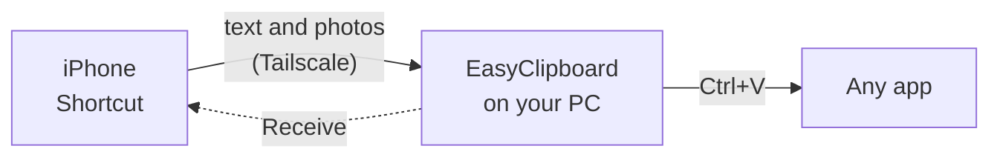
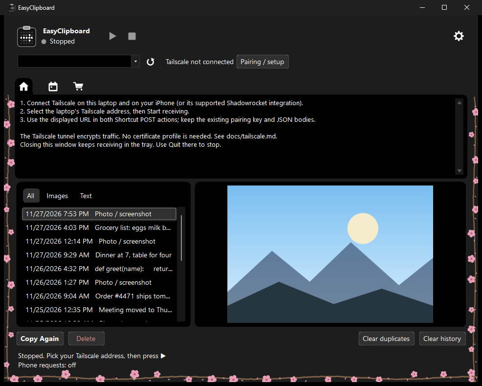
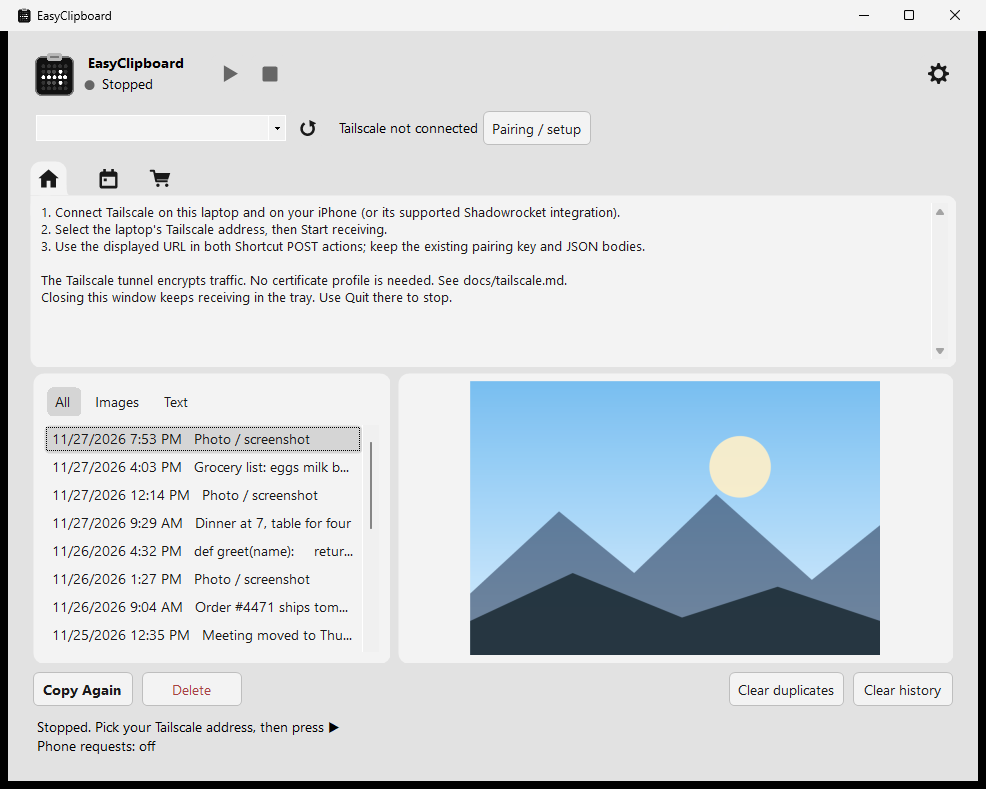
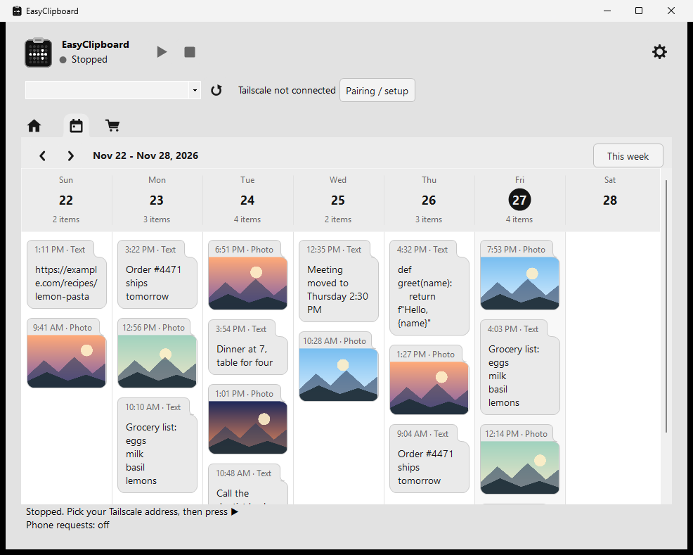
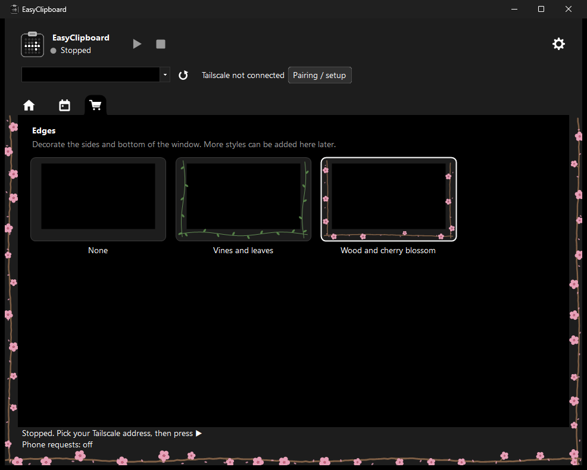

<p align="center"></p>

<h1 align="center">EasyClipboard</h1>

<p align="center">Copy on your iPhone, paste on your Windows PC. And back again.</p>

<p align="center">
  <a href="docs/tailscale-setup.md"><b>1. Set up Tailscale</b></a> ·
  <a href="docs/install.md"><b>2. Set up your iPhone</b></a> ·
  <a href="docs/tips.md"><b>Handy extras</b></a>
</p>

---

## What it does

> [!NOTE]
> **Currently tested only with an iPhone and a Windows PC.** Other phones and computers aren't supported yet.

- **Send:** copy text or a photo on your iPhone, run a Shortcut, press **Ctrl+V** on your PC.
- **Receive:** copy on your PC, run a Shortcut, paste on your iPhone.
- **History:** every item is kept on your PC, encrypted, with a calendar that sorts it by day.
- **Private:** it runs over [Tailscale](https://tailscale.com), your own private network, so it works on any Wi-Fi or cellular. No cloud service stores your clipboard.



## Screenshots

| Home (dark) | Home (light) |
| --- | --- |
|  |  |
| **Calendar** | **Customize** |
|  |  |

<sub>Screenshots use sample data.</sub>

## Get started

| Step | What you do | Guide |
| :---: | --- | --- |
| 1 | Install EasyClipboard on your PC | [Latest release](https://github.com/MinhHoag/EasyClipboard/releases/latest): download and run **Setup** |
| 2 | Install Tailscale on PC and iPhone, same account | [Set up Tailscale](docs/tailscale-setup.md) |
| 3 | Turn on Taildrop, install three Shortcuts **in order**, scan the setup code | [Set up your iPhone](docs/install.md) |
| 4 | Make it one tap: Action button, menu, home screen | [Handy extras](docs/tips.md) |

When you first open EasyClipboard, a short tour shows you where everything is, including which value goes into which Shortcut field. Rerun it any time from **Settings → Tour**.

EasyClipboard checks for updates when it opens and asks before installing one.

## Privacy and security

- History stays on your PC under `%LOCALAPPDATA%\EasyClipboard`, encrypted for your Windows account. Defaults: 30 days, 200 items, 256 MB (**Settings → EasyClipboard → History**).
- Every transfer needs your **pairing key**. You can replace it any time in **Pairing / setup**; old Shortcuts then stop working until you run First time Setup again.
- Receive only reads the PC clipboard when your Shortcut asks, and only while **Settings → Phone fetch** is on.
- Nothing is typed or pasted for you, and nothing watches your iPhone's clipboard.

---

## For developers

### Run from source

Double-click **Start EasyClipboard.cmd**, or run:

```powershell
.\scripts\run.ps1
```

You need the **.NET 10 SDK** (the scripts use a local copy in `.tools/` if present). The first restore needs internet. With **Developer mode** unlocked, **Restart EasyClipboard** in the tray rebuilds and reopens a source build without touching your data.

Run the checks with:

```powershell
.\scripts\check.ps1
```

### Package and publish a release

```powershell
pwsh -File scripts/package.ps1 -Version 0.2.12
```

This builds a self-contained x64 **Setup** and portable ZIP under `artifacts/<version>/release`. Run Setup as your normal Windows user; if it fails, extract the portable ZIP and run `EasyClipboard.exe`, or run Setup with `--log <file>` for diagnostics.

**Updates.** Each build looks for updates on this repository's GitHub Releases (taken from the `origin` remote), or on `-UpdateFeed <https URL>`. Installed copies check on launch and ask before downloading. A Setup file installs the version it was built from; an older Setup reaches the newest version on first launch. A GitHub feed needs the repository to be public, since no token is built into the app.

To publish, set `$env:GITHUB_TOKEN`, then add `-Publish`. The release is uploaded as `v<version>`. Builds without a signing certificate are unsigned.

### More detail

| Topic | Doc |
| --- | --- |
| Protocol, storage, and clipboard design | [architecture.md](docs/architecture.md) |
| Building the Shortcuts by hand | [shortcut.md](docs/shortcut.md), [get-from-pc.md](docs/get-from-pc.md) |
| Tailscale networking and firewall troubleshooting | [tailscale.md](docs/tailscale.md) |
| Home Wi-Fi and hotspot modes (Developer mode) | [setup.md](docs/setup.md), [connection-options.md](docs/connection-options.md) |
| Third-party components | [dependencies.md](docs/dependencies.md) |

Developer mode (**Settings → Developer mode**) unlocks home Wi-Fi and hotspot modes. It is a convenience switch for experiments, not a security control. The pairing key is what protects transfers. Home HTTP mode sends content and the key unencrypted on your local network; Tailscale mode carries the same HTTP inside Tailscale's encrypted tunnel.

### Status

The automated checks cover real loopback HTTP/HTTPS requests, authentication, malformed input, text and image persistence, retries, retention, and reverse transfers, with the Windows clipboard simulated. Text and photo transfers have been tested from an iPhone on home Wi-Fi. Cellular use, hotspot mode, and installer upgrades still need device testing.

No real pairing keys, certificates, or clipboard contents belong in the repository.

## License

[MIT](LICENSE)

<sub>EasyClipboard is not affiliated with or endorsed by Tailscale Inc. or Apple Inc.</sub>
