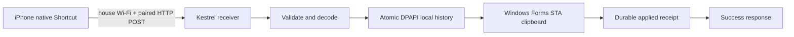

# Architecture and development

Tailscale mode binds only a discovered Tailscale IPv4 interface in `100.64.0.0/10`. Its peer policy accepts other tailnet IPv4 addresses even if the adapter has a /32 mask; ordinary LAN bindings retain their original subnet restriction. All modes still require the pairing key. In Tailscale mode HTTP is protected by Tailscale's tunnel, not by app-level TLS. See [tailscale.md](tailscale.md) for setup and test boundaries.

The prototype uses .NET 10 LTS, Windows Forms, Windows OLE clipboard access via Windows Forms, ASP.NET Core Kestrel, and Windows Wi-Fi Direct WinRT APIs. No custom iPhone app or third-party clipboard/network package is required.

`src/EasyClipboard` is the receiver/UI. `src/EasyClipboard.HotspotProbe` holds the original diagnostic app and shared hotspot lifecycle/binding types. The receiver references it and disables its anonymous probe server. A later cleanup can move shared code to a library.



## Protocol v1

Home HTTP: `POST http://<laptop-IP>:47831/v1/transfers`, `Authorization: Bearer <256-bit-key>`, `Content-Type: application/json`. This mode was explicitly selected to avoid an iPhone profile and accepts unencrypted content/key transport. It binds only the selected local interface/address and serves no certificate profile.

Optional HTTPS: `POST https://<local-IP>:47832/v1/transfers`, with the same headers. In HTTPS modes, 47831 serves public onboarding only and rejects transfers with 426. The API defaults to HTTPS unless `allowHomeHttp: true` is explicitly passed; the UI defaults to the chosen home HTTP mode.

Text:

```json
{
  "version": 1,
  "transferId": "00000000-0000-4000-8000-000000000001",
  "contentType": "text/plain",
  "text": "Hello 👋\nSecond line"
}
```

Image: use `contentType: image/png` and `dataBase64` containing actual PNG bytes; omit `text`. The receiver never follows URLs. The Shortcut explicitly converts other formats to PNG. Optional text `html` accepts basic tags without attributes; plain `text` is always required as fallback.

Success: HTTP 200 with `version:1`, `ok:true`, matching `transferId`, `saved:true`, `clipboardUpdated:true`, and `duplicate` Boolean. Failure: appropriate 4xx/5xx and `{version:1,ok:false,error:{code,message}}`.

Errors: 400 invalid JSON/data, 401 invalid/revoked key, 409 ID conflict, 413 size limit, 415 unsupported type, 426 attempted HTTP transfer, 429 another transfer is processing, 503 paused/clipboard busy, 507 local storage failure. Server log providers are disabled; routine logs never contain content or credentials.

Limits: 18 MB HTTP body, 1 MB UTF-8 plain text, 12 MB decoded/normalized PNG, 20 megapixels, 12000 pixels per image side, four concurrent connections, one decoding/save transaction at a time. Headers/keepalive have Kestrel bounds. There is no production per-client rate limiter yet. Unknown JSON fields and excessive nesting are rejected.

## Storage and clipboard

### On-demand PC-to-phone fetch

`GET /v1/clipboard` uses the same network and Bearer authentication checks. It defaults to disabled and requires the explicit per-session **Allow phone to fetch PC clipboard** checkbox. Successful responses are raw UTF-8 plain text or sanitized PNG with `Cache-Control: no-store`; failures retain the versioned JSON error envelope. HEAD/POST do not read the clipboard. HTTPS-only modes reject HTTP fetches.

`ClipboardExport` permits only one concurrent read, rechecks permission before and after reading/normalization, and invalidates an in-flight request when permission is withdrawn even if re-enabled. `WindowsClipboard.ReadAsync` dispatches to the UI's STA thread, bounds waiting, checks the clipboard sequence for a concurrent change, and reads only PNG/bitmap/text. It does not resolve file paths, HTML resources or URLs. The source shares existing image/text validation limits. No reverse-transfer contents are persisted and the PC clipboard is not changed. Cancelled requests release the read gate; a native clipboard owner that blocks inside an OS/OLE call cannot be forcibly interrupted safely.

The iPhone must run its fetch Shortcut to update its own clipboard; see [get-from-pc.md](get-from-pc.md). Source/sink are simulated in automated tests, so real clipboard ownership and iOS content-type behavior remain end-to-end checks.

Data is validated/fully rasterized before clipboard access. UUID-derived paths prevent path traversal. Files are DPAPI-encrypted, flushed in the destination directory, and atomically renamed. The bank saves a pending item before setting the clipboard, then an applied receipt after successful clipboard access. Success is sent only after both complete.

Network threads dispatch to the Windows Forms STA thread. Windows Forms retries temporary OLE clipboard contention. Images provide Bitmap plus PNG data rather than a path/URL. The prior clipboard's available formats are materialized before replacement. If persisting completion fails, the app attempts restoration unless another application has changed the clipboard meanwhile.

The filesystem and Windows clipboard do not share an atomic transaction. A crash between clipboard update and receipt persistence can leave a pending entry; retrying that ID reapplies it. Native OLE/OS failures after replacement may prevent perfect restoration of unusual/delayed formats. Invalid input, failed decoding, incomplete bodies, and failure to save the pending entry do not reach the clipboard. Atomic recovery across every crash/OS failure is not promised.

An applied transfer with the same ID/payload returns its receipt without copying again or adding history. A different payload under that ID returns 409. Receipts live with retained entries: delete/clear/retention also removes deduplication knowledge. A new button press deliberately creates a new ID. Maintenance failure does not turn a committed transfer into failure; the bank exposes a warning.

## Build and check

```powershell
.\scripts\run.ps1
.\scripts\check.ps1
```

Scripts prefer `.tools/dotnet`, otherwise an installed .NET 10 SDK. The target is Windows 11 22H2+ (`net10.0-windows10.0.22621.0`). SDK/targeting packs are not repository assets. First restore needs NuGet. Outputs and private test data are ignored.

Checks use actual HTTP/HTTPS loopback sockets and disposable DPAPI files with a simulated clipboard. Test certificate validation trusts only the generated test root and retains name/EKU/date checks; it never disables certificate checking or modifies trust stores. The UI preview uses empty test data. Actual hotspot, iPhone Shortcut, live clipboard contention, and cross-app paste remain unverified.

For a framework-dependent release:

```powershell
dotnet publish src\EasyClipboard\EasyClipboard.csproj -c Release -r win-x64 --self-contained false -o artifacts\win-x64
```

The target machine needs .NET 10 Desktop and ASP.NET Core runtimes. Publishing changes the executable path; update the scoped firewall rule accordingly. This is a documented command, not a tested release package. Review [dependencies.md](dependencies.md) before redistribution. There is no installer, signing, autostart setup, public repository, or chosen license yet.
