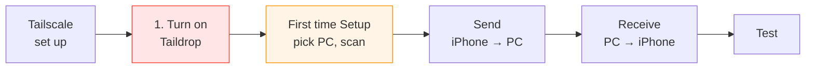
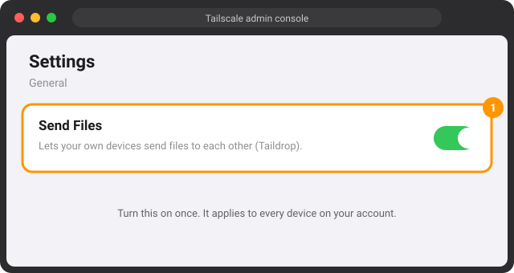
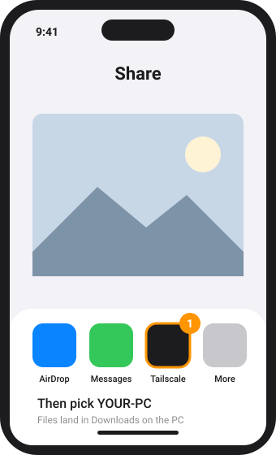
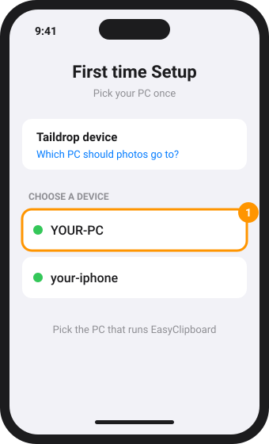
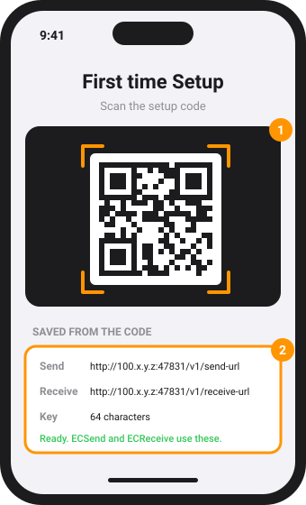
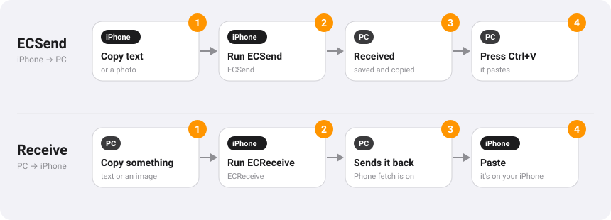
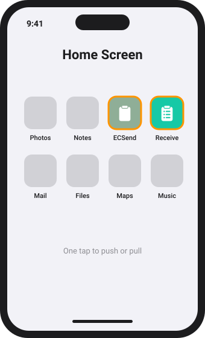
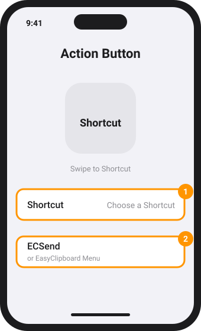

# Set up your iPhone

Three Shortcuts connect your iPhone to EasyClipboard. Install them **in this order**.

**Time:** about 10 minutes · **Before you start:** finish [Set up Tailscale](tailscale-setup.md).

> [!IMPORTANT]
> **Tap "Always Allow" on first run.** The first time each Shortcut reads your clipboard, pastes, sends to your PC or saves your info, iPhone asks for permission. Almost every step asks once. Tap **Always Allow** each time. If you tap **Allow Once**, it asks again on every run.

> [!IMPORTANT]
> **Install "First time Setup" first.** ECSend and ECReceive use what it saves. If you install them first, your iPhone won't find it and the Shortcuts won't work.

| Order | Shortcut | What it does | Install |
| :---: | --- | --- | --- |
| 1 | **First time Setup** | Picks your PC for Taildrop, scans the setup code, and keeps it all in one place | [Get Shortcut][settings] |
| 2 | **ECSend** | Sends what you copied on iPhone to the PC | [Get Shortcut][push] |
| 3 | **ECReceive** | Brings what you copied on the PC to your iPhone | [Get Shortcut][pull] |

---

## Step 1. Turn on Taildrop

**Don't skip this.** Photos travel through Taildrop. Taildrop is still an alpha feature, so it's **off** until you opt in ([Tailscale's docs](https://tailscale.com/docs/features/taildrop#enable-taildrop-for-your-network)). If it's off, nothing tells you: photos just never arrive.

1. On any device, open the admin console's [General settings](https://console.tailscale.com/admin/settings/general) page.
2. Turn on **Send Files**.

**Check it works:** on your iPhone, open a photo, tap **Share → Tailscale** (it may be under **More** the first time), and pick your PC. The photo should land in your PC's **Downloads** folder. If it doesn't, stop here and see [If something doesn't work](#if-something-doesnt-work).

> [!NOTE]
> Screenshot to add: the photo arriving in Downloads on the PC.
<!-- SCREENSHOT: pc-taildrop-downloads.png -->

## Step 2. Show the setup code on your PC

1. Open **EasyClipboard** on your PC.
2. Pick your **Tailscale** address in the network list, then press the green **play** button. The dot under the name turns green.
3. Click **Pairing / setup**. The **iPhone setup code** is at the bottom left: a QR code and the same four lines as text.

| Line | What it is |
| :---: | --- |
| 1 | `EasyClipboard-1`, so the Shortcut knows it scanned the right code |
| 2 | **Send address**: where ECSend sends things |
| 3 | **Receive address**: where ECReceive fetches from |
| 4 | **Pairing key**: 64 characters, only 0–9 and A–F |

> [!NOTE]
> Screenshot to add: Pairing / setup with the setup code at the bottom left.
<!-- SCREENSHOT: pc-setup-code.png -->

> [!CAUTION]
> The setup code contains your pairing key, which works like a password for your clipboard. Don't post it or share a screenshot of it. If it gets out, click **Revoke key and create a new one**; the old code stops working and a new one appears.

## Step 3. Install First time Setup

You run this once, on first use. It pairs your iPhone with your PC.

1. Tap **[Get Shortcut][settings]** on your iPhone, then **Add Shortcut**.
2. Run **First time Setup**. First, pick **your PC** from the device list. This is where Taildrop sends your photos.

3. Next, point the camera at the QR code on your PC.
4. A preview shows what it read: send address, receive address and pairing key. Check they match the four lines on your PC, then confirm.
5. Tap **Always Allow** on any permission prompts.

That's it. ECSend and ECReceive use these saved values from now on, so you don't need to pick or scan again.

> [!TIP]
> Can't scan? Click **Copy all** on the PC, get the text onto your iPhone (for example by saving it to a file and choosing **Send with Tailscale**), copy it there, then run "First time Setup". It reads the same four lines from the clipboard.

> [!NOTE]
> Screenshot to add: First time Setup after a successful scan.
<!-- SCREENSHOT: phone-settings-scan.png -->

**Changed something on the PC?** If you revoke the key or your PC gets a new address, just run "First time Setup" again and scan the new code. You don't need to touch ECSend or ECReceive.

## Step 4. Install ECSend

> [!TIP]
> It's easier if you open this page in GitHub mobile, or send yourself the [Shortcut links](#shortcut-links) at the end of this page.

Tap **[Get Shortcut][push]**, then **Add Shortcut**. ECSend reads your values from "First time Setup" and sends photos through Taildrop, which is why that comes first.

## Step 5. Install ECReceive

> [!TIP]
> It's easier if you open this page in GitHub mobile, or send yourself the [Shortcut links](#shortcut-links) at the end of this page.

Tap **[Get Shortcut][pull]**, then **Add Shortcut**. ECReceive also reads your values from "First time Setup".

> [!NOTE]
> ECReceive only works while **Phone fetch** is on in EasyClipboard (Settings → Phone fetch). It's on by default.

## Step 6. Test it

1. **Send:** copy some text on your iPhone, run **ECSend**, then press **Ctrl+V** on the PC.
2. **Photos:** copy a photo and run ECSend. It arrives through Taildrop and lands on the PC clipboard.
3. **Receive:** copy something on the PC, run **ECReceive**, then paste on your iPhone.

Done.

## Quick use: put it one tap away

Pick where you want ECSend and ECReceive. Tap a heading to open it.

<b>Home screen</b>

1. In **Shortcuts**, press and hold **ECSend**.
2. Tap **Share → Add to Home Screen**, then **Add**.
3. Repeat for **ECReceive**.

<b>Control Center</b> (iOS 18 and later)

1. Swipe down from the top-right corner to open Control Center.
2. Tap **+** at the top left, then **Add a Control**.
3. Search for **Shortcut**, tap it, and choose **ECSend**.
4. Repeat for **ECReceive**.

<b>Action button</b> (iPhone 15 Pro and later)

1. Open **Settings → Action Button**.
2. Swipe to **Shortcut**.
3. Tap **Choose a Shortcut** and pick **ECSend**.

Want both on one button? Make a small menu Shortcut: see [One menu for both](tips.md#one-menu-for-both).

---

### If something doesn't work

| What you see | Try this |
| --- | --- |
| "The action could not run because Tailscale is not running" | Open the **Tailscale** app, make sure it's connected, then run the Shortcut again. Keeps happening? On iPhone go to **Settings → Tailscale** and turn on **Background App Refresh**. |
| It keeps asking for permission | You tapped **Allow Once**. Run it again and tap **Always Allow**. |
| "Couldn't connect" or a timeout | Is Tailscale on for both devices? Is EasyClipboard showing a green dot? |
| "…does not match this running receiver's pairing key" | The saved key is old. Run "First time Setup" and scan the current setup code. |
| "…this receiver expects 64" | Extra spaces or the word "Bearer" got pasted into the key. Paste only the 64-character code. |
| ECSend or ECReceive asks you to pick a Shortcut | You installed them before "First time Setup". Install it, or reinstall in order. |
| Photos don't arrive | Redo the photo check in Step 1. If that fails, **Send Files** is off or Tailscale isn't connected. If it works, run "First time Setup" again and pick the right PC. |
| "Turn on Settings → Phone fetch" | Turn on **Settings → Phone fetch** in EasyClipboard, and make sure it's receiving (green dot). |
| You edited a Shortcut and now it's broken | Compare it with [Inside the Shortcuts](shortcut-structure.md), or reinstall it from the links below. |

### Shortcut links

Send these to your phone, then install them in this order:

1. [First time Setup][settings]
2. [ECSend][push]
3. [ECReceive][pull]

[settings]: https://www.icloud.com/shortcuts/dc20de19b80f4d6e95cb2ba74ee9f623
[push]: https://www.icloud.com/shortcuts/20371d097d0548428b34e02f9c01e29a
[pull]: https://www.icloud.com/shortcuts/3d7599da7e7b489698686dd82afea554
