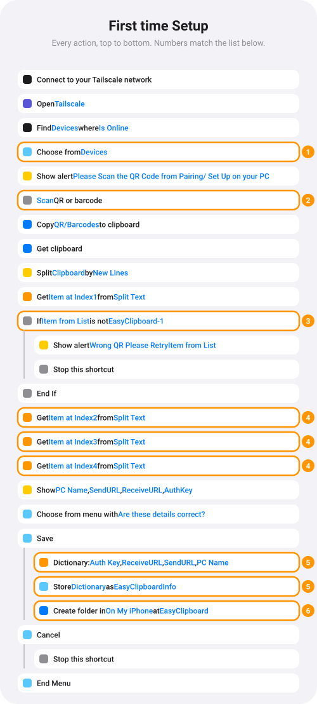
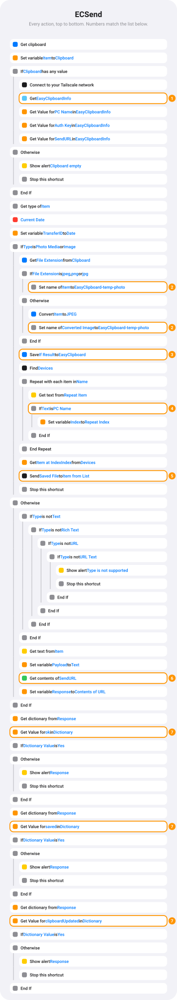
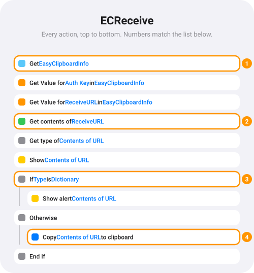

# Inside the Shortcuts

Broke a Shortcut while editing it? Find it below and compare yours with the picture. The orange numbers mark the actions that matter most; everything else can look a little different and still work.

The quickest fix is often to delete the Shortcut and install it again from the [Shortcut links](install.md#shortcut-links). Run **First time Setup** again afterwards.

| Shortcut | What to check first |
| --- | --- |
| [First time Setup](#first-time-setup) | It picks your PC, then reads the QR code, then saves the values |
| [ECSend](#ecsend) | It reads the saved values and sends the clipboard |
| [ECReceive](#ecreceive) | It reads the saved values and copies the reply |

---

## First time Setup

Pairs your iPhone with your PC once. ECSend and ECReceive use what it saves.

The orange numbers mark the actions to check first:

1. **Choose from Devices** lists your online Tailscale devices. The one you pick becomes **PC Name**, which ECSend uses to send photos with Taildrop.
2. **Scan QR or barcode** reads the code in **Pairing / setup** on your PC.
3. **If Item from List is not EasyClipboard-1** checks the first line, so a different QR code is rejected.
4. **Items 2, 3 and 4** are SendURL, ReceiveURL and Auth Key, in that order.
5. **Dictionary** and **Store as EasyClipboardInfo** save all four values. ECSend and ECReceive read them from there.
6. **Create folder** makes the **EasyClipboard** folder in Files that ECSend saves photos into.

## ECSend

Copies your iPhone clipboard to the PC. Text goes straight to EasyClipboard; photos go through Taildrop.

The orange numbers mark the actions to check first:

1. **Get EasyClipboardInfo** reads PC Name, Auth Key and SendURL, saved by "First time Setup".
2. **Set name** uses the fixed name `EasyClipboard-temp-photo`, so the iPhone keeps one file instead of a pile.
3. **Save** uses **If Result**, with **Ask Where to Save** off and **Overwrite If File Exists** on.
4. **If Text is PC Name** finds your PC among your Tailscale devices.
5. **Send** passes the saved photo to Taildrop. EasyClipboard imports it from Downloads.
6. **Get contents of SendURL** posts the text as JSON (`version` 1, `transferId`, `contentType` `text/plain`, `text`) with the header `Authorization: Bearer <Auth Key>`. `transferId` must look like 8-4-4-4-12 hex characters.
7. **ok**, **saved** and **clipboardUpdated** come back from the PC. If any is No, the Shortcut shows the reply.

## ECReceive

Gets your PC clipboard and copies it on the iPhone, text or image.

The orange numbers mark the actions to check first:

1. **Get EasyClipboardInfo** reads Auth Key and ReceiveURL, saved by "First time Setup".
2. **Get contents of ReceiveURL** uses method GET with the header `Authorization: Bearer <Auth Key>`. The PC answers with the clipboard's text or PNG image.
3. **If Type is Dictionary** catches problems. When something goes wrong, the PC answers with a JSON message instead, and the Shortcut shows it.
4. **Copy to clipboard** puts the text or image on your iPhone, ready to paste.

