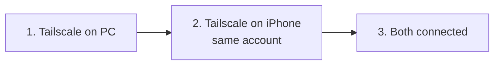
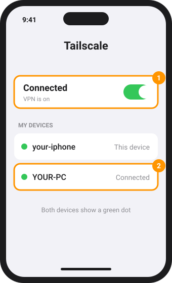

# Set up Tailscale

Do this page **before** installing any Shortcut. EasyClipboard sends your clipboard through Tailscale, a free private network between your own devices. It works on home Wi-Fi, other Wi-Fi, or cellular.

**Time:** about 5 minutes · **You need:** your Windows PC, your iPhone, and one Tailscale account (free).

---

## 1. Install Tailscale on your PC

1. Download Tailscale for Windows from [tailscale.com/download](https://tailscale.com/download) and install it.
2. Sign in. Pick the account you'll also use on your iPhone (Google, Microsoft, Apple, or GitHub).
3. Tailscale sits in the system tray. Make sure it says **Connected**.

> [!NOTE]
> Screenshot to add: Tailscale tray menu on Windows showing "Connected".
<!-- SCREENSHOT: pc-tailscale-tray.png -->

## 2. Install Tailscale on your iPhone

1. Install **Tailscale** from the App Store.
2. Sign in with the **same account** as your PC.
3. When iOS asks to add a VPN configuration, tap **Allow**.

> [!IMPORTANT]
> Use the same account on both devices. Taildrop (file sending) only works between devices that belong to you.

## 3. Connect both devices

On your iPhone, open Tailscale and turn it **on**. Both devices should appear with a green dot.

Then open **EasyClipboard** on your PC. Next to the network list it should say **Tailscale ready**. If it says *Tailscale not connected*, connect Tailscale on the PC and press the refresh button.

Tailscale is ready. Continue with [Set up your iPhone](install.md), which starts by turning on Taildrop.

---

### If something doesn't work

| What you see | Try this |
| --- | --- |
| Your PC isn't in the iPhone's device list | Sign in with the same account on both. Make sure both say Connected. |
| **Tailscale** isn't in the share sheet | Scroll the app row to **More** and turn Tailscale on. |
| The file never arrives | Check **Send Files** is on ([Set up your iPhone, Step 1](install.md#step-1-turn-on-taildrop)) and Tailscale is running on the PC. |
| EasyClipboard says *Tailscale not connected* | Connect Tailscale on the PC, then press refresh in EasyClipboard. |
| A Shortcut says *The action could not run because Tailscale is not running* | Open the Tailscale app on iPhone, then run the Shortcut again. Keeps happening? Go to **Settings → Tailscale** and turn on **Background App Refresh**. |

More detail for unusual networks: [Tailscale troubleshooting](tailscale.md).
