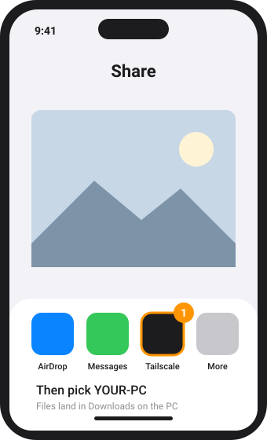
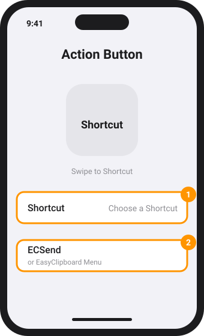
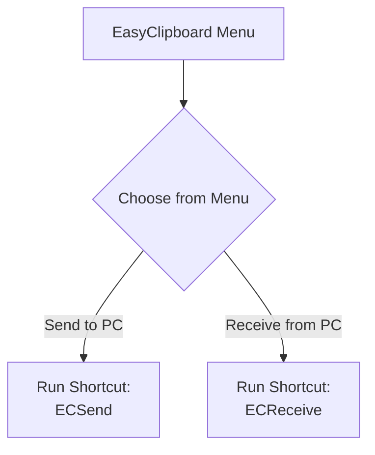
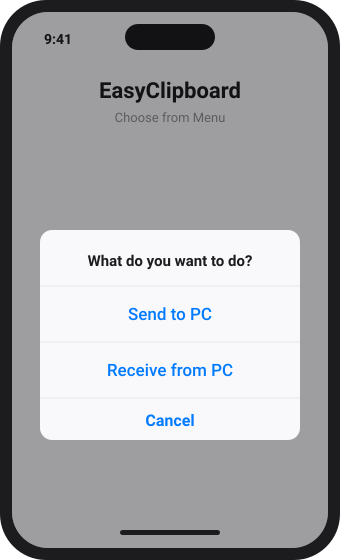
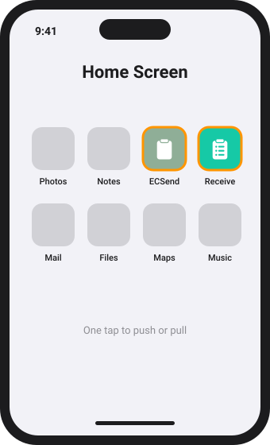

# Handy extras

Once [your iPhone is set up](install.md), these make EasyClipboard one tap away.

| I want to… | Jump to |
| --- | --- |
| Send any file, not just the clipboard | [Send a file with Taildrop](#send-a-file-with-taildrop) |
| Send with one press of a button | [Action button](#action-button) |
| Pick Send or Receive from a little menu | [One menu for both](#one-menu-for-both) |
| Tap an icon on my home screen | [Home screen icons](#home-screen-icons) |
| Tap the back of my phone | [Back Tap](#back-tap) |

---

## Send a file with Taildrop

You don't need EasyClipboard for this. Taildrop is part of Tailscale.

**iPhone → PC**

1. Open the file or photo and tap **Share**.
2. Choose **Tailscale** (it may be under **More** the first time), then your PC.
3. It lands in the PC's **Downloads** folder.

**PC → iPhone**

Right-click the file in File Explorer and choose **Send with Tailscale**, then pick your iPhone. A notification appears on the phone, and the file opens in the **Files** app.

> [!NOTE]
> Screenshot to add: the "Send with Tailscale" right-click menu on Windows.
<!-- SCREENSHOT: pc-send-with-tailscale.png -->

## Action button

On iPhones with an Action button (iPhone 15 Pro and later):

1. Open **Settings → Action Button**.
2. Swipe to **Shortcut**.
3. Tap **Choose a Shortcut** and pick **ECSend**, or the menu Shortcut below to get both.

Now copy something and press the Action button.

## One menu for both

Make a small Shortcut that asks "Send or Receive?" so one button, icon, or Back Tap does both.

1. In **Shortcuts**, tap **+** to make a new Shortcut. Name it **EasyClipboard Menu**.
2. Add the **Choose from Menu** action. Set the prompt to *What do you want to do?* and the two items to **Send to PC** and **Receive from PC**.
3. Under **Send to PC**, add **Run Shortcut** and pick **ECSend**.
4. Under **Receive from PC**, add **Run Shortcut** and pick **ECReceive**.
5. Optional: tap the Shortcut's icon to pick a color and symbol.

> [!NOTE]
> Screenshot to add: the finished EasyClipboard Menu Shortcut in the editor.
<!-- SCREENSHOT: phone-menu-editor.png -->

## Home screen icons

1. In **Shortcuts**, press and hold **ECSend**.
2. Tap **Share**, then **Add to Home Screen**.
3. Optionally rename it to **Send** and pick an icon, then tap **Add**.
4. Repeat for **ECReceive**, or add just the menu Shortcut.

You can also add a **Shortcuts widget** to your home screen to show several Shortcuts at once.

## Back Tap

Double-tap or triple-tap the back of your iPhone to run a Shortcut:

1. Open **Settings → Accessibility → Touch → Back Tap**.
2. Choose **Double Tap** or **Triple Tap**.
3. Scroll to **Shortcuts** and pick **ECSend** or **EasyClipboard Menu**.
